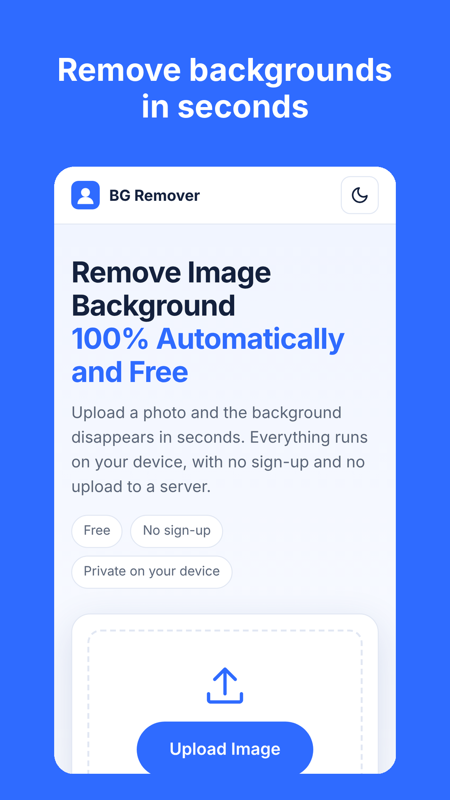
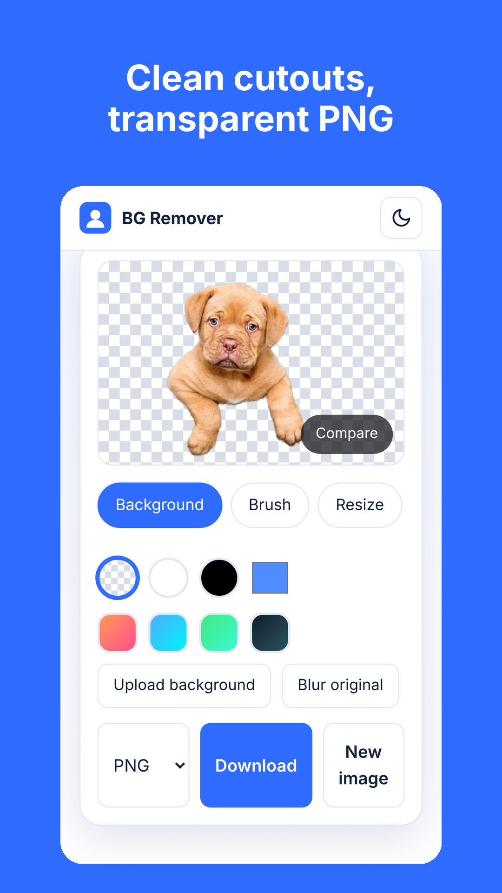
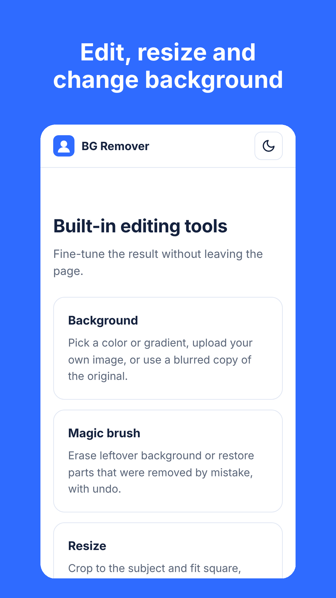

<p align="center">
  
</p>

<h1 align="center">BG Remover</h1>

<p align="center">
  Free, private background remover that runs entirely on your device.<br>
  Web app and Android app. No sign-up, no upload, no watermark.
</p>

<p align="center">
  <b>English</b> | <a href="README.id.md">Bahasa Indonesia</a>
</p>

<p align="center">
  <a href="https://removebg.sbs"></a>
  <a href="LICENSE"></a>
  <a href="https://github.com/RayHanC4-Lua/bgremover/actions/workflows/android.yml"></a>
  
</p>

<p align="center">
  
  
  
</p>

## Try it

- **Web:** https://removebg.sbs
- **Android:** currently in closed testing on Google Play. Want to help? See [Become a tester](#become-a-tester).

## Features

- **Automatic cutout** with a lightweight AI model (U2-Net-P) and edge refinement
- **Portrait HD mode** with MODNet for finer hair and edges
- **100% on-device:** images are processed in your browser or phone and are never uploaded
- **Editing tools:** replace the background with a color, gradient, your own image or a blurred original, magic brush to erase or restore with undo, resize presets, shadow and outline
- **Before and after** compare slider
- **Export** as PNG, JPG or WebP. The Android app saves straight to the gallery
- **Works offline** after the first load (PWA)
- **Light and dark mode**
- Drag and drop, file picker, or paste from clipboard

## How it works

1. The image is decoded and scaled down to a maximum of 2048 px on the longest side.
2. A Web Worker runs the U2-Net-P ONNX model with ONNX Runtime Web (WASM) to produce a mask.
3. The mask is upscaled and refined with a guided filter so edges follow the original image.
4. The mask becomes the alpha channel of the cutout. Everything stays in memory on your device.

## Tech stack

| Part | Technology |
|---|---|
| Web app | Vanilla HTML, CSS and JavaScript. No framework, no build step |
| AI runtime | ONNX Runtime Web (WASM) inside Web Workers |
| Models | U2-Net-P (about 4 MB), MODNet for Portrait HD (about 25 MB) |
| Hosting | Cloudflare Workers static assets, auto-deployed on push |
| Android app | Native Java WebView shell, Android 7.0 (API 24) and up, target API 36 |
| Android CI | GitHub Actions builds a signed AAB and APK |
| Tester sign-up | Cloudflare Worker with Turnstile, stored in Supabase |

## Project structure

```
bgremover/
  public/                 Website served at removebg.sbs
    index.html            Main tool
    about/ contact/ privacy/ testers/
    js/                   App logic, workers, editor, animations
    css/style.css
    models/               ONNX models
    vendor/ort/           ONNX Runtime Web
    sw.js                 Service worker (offline cache)
    manifest.webmanifest
  android/                Android app (WebView shell)
  store/                  Google Play icon, feature graphic, screenshots
  src/worker.js           API for tester sign-ups (Turnstile check)
  supabase/testers.sql    Table for tester sign-ups
  supabase/testers_lock.sql  Lets only the Worker add testers
  .github/workflows/      Android build pipeline
  wrangler.jsonc          Cloudflare config
```

## Run locally

You need Python 3. The page cannot be opened with `file://`, so use a local server:

```bash
git clone https://github.com/RayHanC4-Lua/bgremover.git
cd bgremover
python -m http.server 8080 -d public
```

Then open http://localhost:8080.

Works the same in Termux on Android.

## Deploy the website

1. Fork or push this repo to GitHub.
2. In the Cloudflare dashboard, open Workers & Pages, choose Create, and connect the repo.
3. Leave the build command empty. Keep the deploy command as `npx wrangler deploy`.
4. Every push to the main branch redeploys the site.

The service worker is cache-first. After changing files in `public/`, bump `CACHE` in `public/sw.js` (for example `app-v14` to `app-v15`) so users get the new version.

## Build the Android app

The Android app is a native WebView shell that loads `https://removebg.sbs/?source=app`. Website changes reach the app instantly. You only need a new build when something in `android/` changes.

1. Create an upload keystore and add two repository secrets:
   - `ANDROID_KEYSTORE_BASE64`: the keystore encoded with `base64 -w0`
   - `ANDROID_KEYSTORE_PASSWORD`: its password (key alias `upload`)
2. Open the Actions tab, run **Android build**, and enter a version name.
3. Download the artifact. It contains `app-release.aab` for Google Play and `app-release.apk` for testing.

The version code increases automatically with every run.

## Become a tester

Google Play requires 12 testers for 14 days before a new app can go public. If you have an Android phone, sign up at **https://removebg.sbs/testers** and install the app from Google Play. Thank you!

## Limitations

- Very fine hair or transparent objects may not be perfect with the standard model. Try Portrait HD for people.
- The longest side of the image is limited to 2048 px.
- Speed depends on your device.

## Contributing

Bug reports, ideas and pull requests are welcome. Please read [CONTRIBUTING.md](CONTRIBUTING.md) first. For security issues, see [SECURITY.md](SECURITY.md).

## License and credits

The code is released under the [MIT License](LICENSE).

- [U2-Net](https://github.com/xuebinqin/U-2-Net) by Xuebin Qin et al., Apache License 2.0. ONNX file from the [rembg](https://github.com/danielgatis/rembg) releases.
- [MODNet](https://github.com/ZHKKKe/MODNet) by Zhanghan Ke et al., Apache License 2.0. ONNX export from [Xenova/modnet](https://huggingface.co/Xenova/modnet).
- [ONNX Runtime Web](https://github.com/microsoft/onnxruntime) by Microsoft, MIT License.

If you swap in another model, check its license first. Some popular models, such as BRIA RMBG, do not allow commercial use.

BG Remover is an independent project and is not affiliated with remove.bg or Canva.

## Support

If this tool helps you, you can support it on [Trakteer](https://trakteer.id/areeyhanc/tip?open=true).

Made by [RyHanC](https://ryhanc.wtf/).
